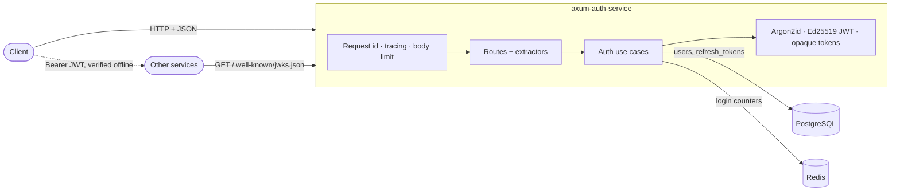
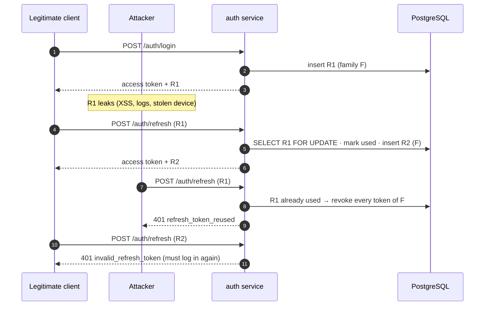

# axum-auth-service

[](https://github.com/mhxtecnologia/axum-auth-service/actions/workflows/ci.yml)


An authentication service written in Rust with [Axum](https://github.com/tokio-rs/axum):
registration, login, token refresh and logout, built the way a production identity
service should be — Argon2id password hashing, **Ed25519-signed JWTs** that any other
service can verify offline through a **JWKS** endpoint, and **opaque refresh tokens with
rotation and reuse detection**.

- **Passwords**: Argon2id (OWASP parameters), hashing off the async runtime, constant-time
  answer for unknown emails.
- **Access tokens**: short-lived JWTs signed with Ed25519; public key at
  `/.well-known/jwks.json` (RFC 7517 / RFC 8037), `kid` = RFC 7638 thumbprint.
- **Refresh tokens**: 256-bit opaque tokens, stored only as SHA-256, single use; replaying an
  old token revokes the whole session family.
- **Brute-force protection**: per-email and per-IP login rate limit in Redis.
- **Operations**: structured JSON logs with request ids, liveness/readiness probes, layered
  configuration per environment, OpenAPI 3.1 + Swagger UI, distroless Docker image.

## Architecture



| Layer | Path | Responsibility |
|---|---|---|
| Bootstrap | `src/startup.rs`, `src/configuration.rs`, `src/telemetry.rs` | Config layers, pools, router, graceful shutdown, logs |
| HTTP | `src/routes/`, `src/extract.rs`, `src/error.rs`, `src/openapi.rs` | Handlers, `Bearer`/client-IP extractors, error shape, OpenAPI |
| Use cases | `src/auth.rs`, `src/domain.rs` | Register, login, refresh rotation, logout, input rules |
| Infrastructure | `src/crypto/`, `src/repository/`, `src/rate_limit.rs` | Hashing and signing, SQL, Redis counters |

### Refresh token rotation and reuse detection

Every login starts a **family**. Each refresh consumes the presented token and issues a new
one in the same family. A refresh token is valid exactly once, so if an already-used token
shows up again, two parties hold a copy of it — one of them stole it. The service cannot
tell which one is legitimate, so it revokes the entire family and both must log in again.



`SELECT ... FOR UPDATE` serializes concurrent refreshes of the same token: the second request
sees the first one's `used_at` and is treated as reuse, so there is no race window.

## Technical decisions

| Decision | Why |
|---|---|
| **Ed25519 (EdDSA) instead of HS256** | Asymmetric: services that only *verify* tokens get the public key from the JWKS and never hold a secret that can mint tokens. Ed25519 keys are small, signing is fast and deterministic (no RNG failure modes). |
| **Small, strict JWS implementation** | The verifier accepts exactly one algorithm and one key; the header is only compared, never used to pick how to verify. `alg: none` and algorithm-confusion attacks are impossible by construction. `verify_strict` rejects malleable signatures. Covered by unit tests, including the RFC 8037 test vector. |
| **Opaque refresh tokens, hashed with SHA-256** | Refresh tokens must be revocable, so they live in the database anyway — a JWT would add nothing. With 256 bits of entropy there is no dictionary to attack, so a fast hash is enough and allows an indexed lookup. A database leak does not leak usable tokens. |
| **Short access tokens (15 min)** | Access tokens are stateless and cannot be revoked; logout and reuse detection act on refresh tokens, and the access token simply expires. |
| **Argon2id with OWASP parameters, in `spawn_blocking`** | Memory-hard hashing (19 MiB, t=2, p=1) without stalling the Tokio worker threads. Unknown emails still pay for one verification against a dummy hash, so response time does not reveal which accounts exist. |
| **Rate limit counted *before* the password check** | The attempt is counted atomically (`MULTI` + `INCR` + `EXPIRE NX`) before Argon2 runs, so a blocked attacker also stops burning CPU. A successful login resets the per-email counter; the per-IP counter only expires, so an attacker's own valid account cannot reset it. IPv6 clients are bucketed per /64. |
| **Fail closed when Redis is down** | Login answers `503` instead of silently allowing unlimited guesses. |
| **`X-Forwarded-For` ignored by default** | Otherwise any client could pick its own IP and bypass the per-IP limit. Behind a trusted proxy, enable `rate_limit.trust_x_forwarded_for` and the last hop is used. |
| **Runtime SQL (`query_as`) instead of `query!` macros** | The Docker build and `cargo clippy` do not need a live database or an offline query cache. The integration tests run every query against real PostgreSQL instead. |
| **Layered configuration** (Zero to Production style) | `base.yaml` → `local.yaml`/`production.yaml` → `APP_*` environment variables. Secrets use `secrecy` so they never show up in `Debug` output, and production refuses to start without a password, Redis URL and signing key. |

## Running

### Everything with one command

```bash
docker compose up --build
```

Then open **http://localhost:8080/docs** (Swagger UI). The stack starts PostgreSQL 17,
Redis 7 and the API; migrations run on startup and a development signing key is generated
in a Docker volume on first boot.

Try it from the terminal:

```bash
curl -s -X POST localhost:8080/auth/register -H 'content-type: application/json' \
  -d '{"email":"ada@example.com","password":"correct horse battery staple"}'

curl -s -X POST localhost:8080/auth/login -H 'content-type: application/json' \
  -d '{"email":"ada@example.com","password":"correct horse battery staple"}'

curl -s localhost:8080/users/me -H "authorization: Bearer <access_token>"
```

### Locally with Cargo

```bash
docker compose up -d postgres redis
cargo run
```

`APP_ENVIRONMENT` defaults to `local`, which uses `configuration/local.yaml` and writes a
development key to `keys/jwt-ed25519.pem` (git-ignored).

## Endpoints

| Method | Path | Description |
|---|---|---|
| `POST` | `/auth/register` | Create an account (`201`, `409` if the email exists, `422` on invalid input) |
| `POST` | `/auth/login` | Exchange email + password for an access token and a refresh token (`429` + `Retry-After` when rate limited) |
| `POST` | `/auth/refresh` | Rotate the refresh token and get a new pair |
| `POST` | `/auth/logout` | Revoke the session of a refresh token (always `204`) |
| `GET` | `/users/me` | Current user (requires `Authorization: Bearer <access_token>`) |
| `GET` | `/.well-known/jwks.json` | Public signing key (JWKS) |
| `GET` | `/health/live`, `/health/ready` | Liveness and readiness (PostgreSQL + Redis) |
| `GET` | `/docs`, `/api-docs/openapi.json` | Swagger UI and the OpenAPI document |

Errors always have the same shape, with a stable `code` for clients:

```json
{ "error": { "code": "refresh_token_reused", "message": "refresh token was already used; the whole session was revoked" } }
```

## Configuration

Every key in `configuration/*.yaml` can be overridden with an environment variable:
`APP_<SECTION>__<KEY>`, for example `APP_DATABASE__HOST=db.internal`.

| Variable | Default | Notes |
|---|---|---|
| `APP_ENVIRONMENT` | `local` | `local` or `production` |
| `APP_DATABASE__PASSWORD` | — | Required in production |
| `APP_DATABASE__REQUIRE_SSL` | `true` in production | TLS to PostgreSQL |
| `APP_REDIS__URL` | — | Required in production |
| `APP_JWT__PRIVATE_KEY_PEM` | — | Ed25519 PKCS#8 PEM (`openssl genpkey -algorithm ed25519`); or use `APP_JWT__PRIVATE_KEY_PATH` |
| `APP_JWT__ACCESS_TOKEN_TTL_SECONDS` | `900` | |
| `APP_REFRESH_TOKEN__TTL_SECONDS` | `2592000` | 30 days |
| `APP_RATE_LIMIT__LOGIN_MAX_ATTEMPTS_PER_EMAIL` | `5` | Per window |
| `APP_RATE_LIMIT__LOGIN_MAX_ATTEMPTS_PER_IP` | `20` | Per window |
| `APP_RATE_LIMIT__WINDOW_SECONDS` | `900` | |
| `APP_RATE_LIMIT__TRUST_X_FORWARDED_FOR` | `false` | Enable only behind a trusted proxy |
| `RUST_LOG` | from config | Overrides the log filter |

Logs are JSON in production; every line emitted while serving a request carries its
`request_id`, which is also returned in the `x-request-id` header (an incoming one is kept,
so a trace can cross services).

## Tests

```bash
docker compose up -d postgres redis
cargo test
```

- **Unit tests** cover the JWT implementation (round trip, expiry, tampering, `alg: none`,
  foreign keys, wrong audience, RFC 8037 vector), Argon2id hashing, refresh token generation,
  email/password rules and IP bucketing.
- **Integration tests** (`tests/api/`) start the real application on a random port. Each
  test gets a fresh PostgreSQL database with the migrations applied and its own Redis key
  prefix, so tests run in parallel without sharing state. They cover the full HTTP contract:
  registration, login, offline verification of the JWT with the public JWKS, refresh
  rotation, reuse detection revoking the family (and only that family), logout, expiry, rate
  limiting (per email, per IP, spoofed and trusted `X-Forwarded-For`), body size limit,
  request ids and the OpenAPI document.

CI runs `cargo fmt --check`, `cargo clippy -D warnings` and the full test suite against
PostgreSQL and Redis service containers, then builds the Docker image and smoke-tests the
`docker compose` stack.

## Out of scope

Email verification, password reset, MFA and signing-key rotation (a JWKS can list several
keys, so rotation means publishing the new key before signing with it).
Expired refresh tokens are kept for auditing; a periodic job would prune them.

## License

[MIT](LICENSE) © Matheus Henrique Takeuchi
